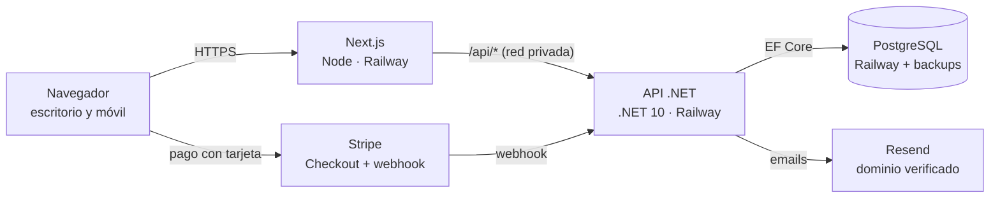
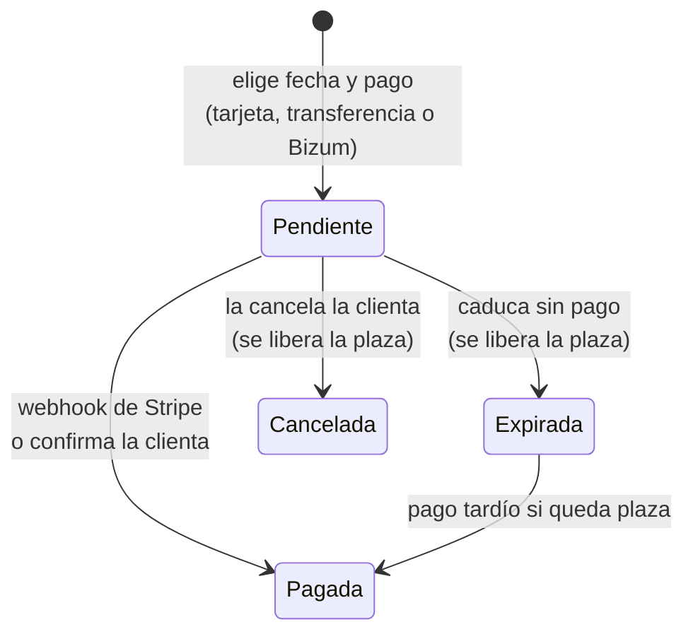

# PRD — Web de venta de cursos

3 de noviembre de 2026 · Jesús

> Exportado del documento original del PRD. Los dos diagramas se han convertido a Mermaid y se han incorporado los ajustes que salieron al detallar las features (ver "Cambios respecto a la primera versión" al final).

## Resumen y objetivos

Web para vender plazas de 4 cursos con ediciones en fechas concretas y plazas limitadas. La clienta gestiona las fechas y ve los inscritos desde un backoffice; los cursos los mantiene el desarrollador.

- Vender plazas con tarjeta (Stripe Checkout) o por transferencia/Bizum con confirmación manual.
- Captar interesados en una lista de espera por curso para llamarles cuando se abran fechas.
- Que la clienta publique fechas y consulte inscritos y lista de espera sin depender del desarrollador.

El diseño (escritorio y móvil) lo entrega un diseñador en Figma; este documento cubre comportamiento, datos y arquitectura.

## Alcance

La v1 cubre la web pública, el flujo de reserva con dos métodos de pago, la lista de espera y el backoffice; reembolsos y automatizaciones de postventa quedan fuera.

**Incluido en la v1**

- Web pública: 2 vistas + contacto, con layouts propios en escritorio y móvil según el Figma.
- Cursos y ediciones cargados dinámicamente desde la API.
- Reserva: calendario de ediciones con plazas restantes → pago con tarjeta (Stripe Checkout) o transferencia/Bizum.
- Lista de espera por curso (formulario sencillo).
- Formulario de contacto (envía email, no guarda en base de datos).
- Emails transaccionales al comprador y avisos a la clienta.
- Backoffice de la clienta: CRUD de ediciones, inscritos, reservas pendientes, lista de espera, exportación CSV.
- CRUD de cursos solo para el desarrollador. Los 4 cursos iniciales van incluidos; cada curso nuevo se presupuesta aparte.

**Fuera de la v1**

- Reembolsos automáticos: se hacen desde Stripe y la plaza se libera a mano.
- Cambio de fecha de un inscrito, códigos de descuento, recordatorios antes del curso.
- Notificación automática a inscritos si cambia la fecha de una edición.
- Subida de imágenes desde el backoffice: las imágenes de los cursos van en el front (`public/`).
- Recuperación de contraseña por email (el desarrollador la resetea, ver F01).

**Dependencias externas**

- Diseño en Figma (diseñador).
- Cuenta de Stripe, dominio y cuenta de Resend a nombre de la clienta.
- Textos legales (aviso legal, privacidad, cookies, condiciones de compra) los aporta la clienta.

## Arquitectura y despliegue

Dos servicios en Railway desde un monorepo: Next.js para la web y el backoffice, y la API .NET de la plantilla con PostgreSQL.

Next reenvía `/api/*` a la API por la red privada de Railway, así que en producción todo va por el mismo origen y sin CORS.

- **Monorepo:** `src/` y `tests/` (plantilla .NET 10: Clean Architecture, MediatR, FluentValidation, EF Core + Npgsql), `web/` (Next.js), `.github/workflows/`.
- **Next.js** con `output: 'standalone'` y SSR, para que ediciones y plazas salgan en el HTML inicial. Rewrite de `/api/*` a `API_INTERNAL_URL`.
- **API** sin dominio público salvo que el webhook de Stripe lo necesite. Kestrel escuchando en todas las interfaces (`http://[::]:8080`).
- **Railway:** servicio web con root directory `web/` y watch paths `web/**`; servicio API con el Dockerfile de la plantilla y watch paths `src/**`, `tests/**`; PostgreSQL gestionado. Entornos `staging` y `production`.
- **CI** en GitHub Actions: tests unitarios y de integración (Testcontainers), lint y build del front. Railway espera al CI antes de desplegar.
- **MediatR:** comprobar la versión de la plantilla; si es 13 o superior, registrar la clave Community (gratuita por debajo de 5 M$ de facturación anual).
- **Imágenes** de los cursos en `web/public/`, sin volumen.

## Modelo de datos

Cinco entidades de negocio: Curso, Edición, Reserva (una sola para tarjeta y transferencia), ListaEspera y el registro de eventos de Stripe. Las fechas se guardan en UTC (`DateTimeOffset`) y se muestran en Europe/Madrid. El detalle completo de campos está en F02, F03 y F05; las tablas técnicas de apoyo (`EmailSaliente`, `AvisoEnviado`) en F06 y F11.

**Curso** (lo gestiona el desarrollador)

| Campo | Tipo | Notas |
| --- | --- | --- |
| Id | Guid | |
| Nombre, Slug | string | Slug único, para URLs |
| DescripcionCorta, Descripcion | string | |
| Precio | decimal (EUR) | Pendiente confirmar si incluye IVA |
| Imagen | string | Ruta en `public/` del front |
| Ubicacion, DuracionTexto | string? | Para la ficha y los emails |
| Activo, Orden | bool, int | Orden de aparición en la web |

**Edición** (la gestiona la clienta)

| Campo | Tipo | Notas |
| --- | --- | --- |
| Id | Guid | |
| CursoId | Guid | FK a Curso |
| Inicio | DateTimeOffset | UTC |
| Plazas | int | Total de plazas |
| Estado | enum | Programada, Oculta, Cancelada |
| Version | xmin | Concurrencia optimista en las ediciones del backoffice |

Plazas libres = Plazas − reservas Pagadas − reservas Pendientes no caducadas. Se calcula, no se guarda.

**Reserva**

| Campo | Tipo | Notas |
| --- | --- | --- |
| Id | Guid | |
| Codigo | string | Único, no secuencial (p. ej. `CUR-7K4Q2M`), sin caracteres ambiguos |
| EdicionId | Guid | FK a Edición |
| Metodo | enum | Stripe, Manual |
| Estado | enum | Pendiente, Pagada, Expirada, Cancelada |
| Nombre, Email, Telefono | string | Teléfono obligatorio, normalizado E.164 |
| Importe | decimal (EUR) | Copia del precio al reservar |
| StripeSessionId | string? | Solo método Stripe |
| ExpiraEn | DateTimeOffset | Caducidad del bloqueo de plaza |
| RequiereRevision | bool | Pago recibido sin plaza disponible |
| PagadaEn, CreadaEn | DateTimeOffset | |

**ListaEspera**

| Campo | Tipo | Notas |
| --- | --- | --- |
| Id | Guid | |
| CursoId | Guid | FK a Curso |
| FechaPreferida | string? | Opcional, texto libre o edición |
| Nombre, Email, Telefono | string | Teléfono obligatorio |
| ConsentimientoEn, TextoConsentimiento | DateTimeOffset, string | Prueba del consentimiento RGPD |
| Contactado, ContactadoEn | bool, DateTimeOffset? | Marca de la clienta |
| BajaToken, BajaEn | string, DateTimeOffset? | Para el enlace de baja de los avisos |

Mismo email + curso no duplica: actualiza el registro existente.

**StripeEvento** (idempotencia del webhook)

| Campo | Tipo | Notas |
| --- | --- | --- |
| EventId | string (PK) | `evt_…` de Stripe |
| Tipo, ProcesadoEn | string, DateTimeOffset | |

Los usuarios del backoffice reutilizan la entidad de usuario de la plantilla, con rol `Admin` (clienta) o `SuperAdmin` (desarrollador).

## Flujos de usuario

Los dos métodos de pago crean la misma Reserva en estado Pendiente; solo cambia quién la confirma.

Pagadas y pendientes vigentes ocupan plaza; expiradas y canceladas la devuelven al calendario.

**Reserva con tarjeta**

1. «Reservar» lleva al calendario del curso con las ediciones y sus plazas libres. Las completas aparecen como «Completo» con botón a la lista de espera.
2. Elige edición y «Tarjeta» y rellena nombre, email y teléfono.
3. La API crea la Reserva en Pendiente y la sesión de Stripe Checkout, y redirige al pago.
4. El webhook `checkout.session.completed` la pasa a Pagada y dispara los emails. El comprador vuelve a una página de éxito con su código.
5. Si abandona, la plaza se libera al volver a la web o, como máximo, cuando expira la sesión (`checkout.session.expired`).

**Transferencia o Bizum**

1. Elige edición y «Transferencia o Bizum» y rellena el mismo formulario.
2. La API crea la Reserva en Pendiente con código único y caducidad.
3. Página de instrucciones: titular, IBAN, teléfono de Bizum, importe, código para el concepto, fecha de caducidad y botón de WhatsApp con el mensaje ya escrito (`wa.me/<tel>?text=…<código>`). El mismo contenido llega por email.
4. La clienta recibe el comprobante por WhatsApp, busca la reserva por código en el backoffice y confirma el pago: pasa a Pagada y sale el email de confirmación.
5. Sin confirmación antes de la caducidad, el job la pasa a Expirada.

**Lista de espera**

1. Desde una edición completa o desde la ficha del curso: curso, fecha preferida (opcional), nombre, teléfono, email y casilla RGPD.
2. Se guarda sin duplicar email + curso y se avisa a la clienta.
3. La clienta llama y la marca como contactada.

## Backoffice

La clienta (rol `Admin`) gestiona ediciones, confirma pagos manuales y consulta inscritos y lista de espera; el CRUD de cursos solo lo ve el desarrollador (rol `SuperAdmin`). Debe ser cómodo en móvil: los comprobantes llegan por WhatsApp y lo normal es confirmar desde el teléfono.

| Pantalla | Rol | Qué hace |
| --- | --- | --- |
| Portada | Admin | Buscador por código, pendientes, revisiones, interesados sin contactar, próximas ediciones |
| Ediciones | Admin | Listado por curso con fecha, plazas, pagadas, pendientes y libres. Crear, editar, ocultar y cancelar |
| Detalle de edición | Admin | Inscritos (pagadas) y pendientes con nombre, teléfono, email, método y fecha. Exportar CSV |
| Reservas pendientes | Admin | Todas las pendientes, ordenadas por caducidad. Buscar por código, teléfono o nombre. Confirmar pago, cancelar, ampliar caducidad |
| Lista de espera | Admin | Filtro por curso, marca de contactado, exportar CSV |
| Cuenta | Admin | Cambiar contraseña |
| Cursos | SuperAdmin | CRUD de cursos, oculto en la interfaz de la clienta |
| Emails | SuperAdmin | Vista previa de los emails |

La seguridad está en la API (`[Authorize(Policy = …)]` en cada endpoint); que el front oculte pantallas no protege nada.

## Reglas de negocio y casos límite

La regla central: toda reserva bloquea su plaza desde que se crea hasta que se paga, caduca o se cancela, y nunca se vende más de lo que hay.

**Plazas y concurrencia**

- Crear una reserva bloquea la fila de la edición (`SELECT … FOR UPDATE`), comprueba plazas libres e inserta la reserva en la misma transacción. Sin plaza → 409 y la web ofrece la lista de espera.
- No se puede bajar `Plazas` por debajo de pagadas + pendientes vigentes.
- Límite de reservas pendientes a la vez por teléfono y por email (configurable).

**Ediciones**

- Se ocultan de la web y no admiten reservas cuando ya empezaron o cuando faltan menos de las horas de cierre configuradas.
- Ocultas o canceladas: no se muestran ni se reservan.
- No se borra una edición con reservas: solo se oculta o cancela.
- Cambiar la fecha de una edición con reservas muestra el aviso «Esta edición tiene X inscritos, tendrás que avisarles». En la v1 no se notifica automáticamente.

**Stripe**

- La sesión de Checkout se crea con `expires_at` = ahora + minutos de bloqueo (Stripe exige mínimo 30) y la reserva en Pendiente con esa caducidad más un margen de 5 minutos.
- `checkout.session.completed` → Pagada. `checkout.session.expired` → Expirada.
- Se verifica la firma del webhook y se registra el `event.id`; un evento repetido no se procesa dos veces.
- Pago completado de una reserva ya Expirada: si queda plaza, pasa a Pagada; si no, queda marcada para revisión y se avisa a la clienta para reembolsar desde Stripe.

**Pago manual (transferencia/Bizum)**

- La reserva nace Pendiente con caducidad en horas configurables (recortada al cierre de la edición).
- Un job en segundo plano expira cada pocos minutos las pendientes vencidas y libera la plaza.
- La clienta puede ampliar la caducidad de una pendiente.
- Confirmar el pago de una reserva ya Expirada solo se permite si queda plaza.

**Formularios públicos**

- Rate limiting por IP real en reservas, lista de espera y contacto, además de `/api/auth/*`.
- Honeypot antispam en todos los formularios públicos.
- Teléfono obligatorio en reservas y lista de espera; validación con FluentValidation.

## Notificaciones por email

Todos los emails salen por Resend desde el dominio de la clienta, verificado con SPF, DKIM y DMARC desde el primer día para que no acaben en spam. Se envían desde una bandeja de salida con reintentos, para que un fallo de Resend no afecte a reservas ni webhooks.

| Evento | Destinatario | Contenido |
| --- | --- | --- |
| Pago con tarjeta completado | Comprador | Confirmación: curso, fecha, código de reserva |
| Pago con tarjeta completado | Clienta | Aviso de venta con datos del comprador |
| Reserva manual creada | Comprador | Datos bancarios y Bizum, código, caducidad, enlace de WhatsApp |
| Reserva manual creada | Clienta | Aviso de reserva pendiente |
| Pago manual confirmado | Comprador | Confirmación: curso, fecha, código |
| Reserva manual caducada | Comprador | Aviso de que la plaza se ha liberado |
| Pago tras caducidad sin plaza | Clienta | Revisar y reembolsar desde Stripe |
| Alta en lista de espera | Clienta | Datos del interesado y curso |
| Formulario de contacto | Clienta | Mensaje del formulario |

Plantillas en español, con el código de reserva visible en asunto y cuerpo.

## Configuración por variables de entorno

Los parámetros de negocio y los secretos van en variables de entorno de Railway. La lista completa, con valores de staging y producción, está en F10.

| Variable | Ejemplo | Uso |
| --- | --- | --- |
| `Reservas__StripeMinutosBloqueo` | 30 | Caducidad de la sesión de Checkout |
| `Reservas__ManualHorasCaducidad` | 48 | Caducidad de las pendientes manuales |
| `Reservas__MaxPendientesPorContacto` | 2 | Límite por teléfono y por email |
| `Reservas__CierreHorasAntes` | 24 | Cierre de reservas antes del inicio |
| `Reservas__JobIntervaloMinutos` | 5 | Frecuencia del job de caducidad |
| `Reservas__UmbralUltimasPlazas` | 3 | A partir de cuántas libres se muestra «últimas plazas» |
| `Pago__Titular`, `Pago__Iban`, `Pago__BizumTelefono`, `Pago__WhatsAppTelefono` | — | Datos del pago manual |
| `Admin__SeedEmail`, `Admin__SeedPassword` | — | Usuario de la clienta |
| `SuperAdmin__SeedEmail`, `SuperAdmin__SeedPassword` | — | Usuario del desarrollador |

## Seguridad, RGPD y operación

Tres cambios a la plantilla son obligatorios antes de cualquier feature: registro cerrado, IP real tras los proxies y tokens fuera de localStorage.

**Seguridad**

- `/api/auth/register` eliminado. Usuarios creados por seed desde variables de entorno, con roles `Admin` y `SuperAdmin`.
- Refresh token en cookie `HttpOnly` + `Secure` + `SameSite=Strict`; access token solo en memoria del front.
- Todos los controllers bajo el prefijo `/api`.
- `UseForwardedHeaders` configurado para el proxy de Railway y el de Next. Comprobar en logs que la API ve la IP del cliente.
- Webhook de Stripe: comprobar que la firma se verifica a través de la rewrite de Next; si falla, dominio público del backend solo para el webhook.
- Swagger desactivado en producción.

**RGPD**

- Casilla de consentimiento en la lista de espera, redactada para cubrir también el aviso por email de nuevas fechas, y guardada con su texto.
- Enlace a la política de privacidad en los formularios; aviso legal y política de cookies en el pie.
- Banner de cookies solo si se añade analítica.
- Los emails ya enviados se borran de la bandeja de salida a los 90 días.

**Operación**

- Backups de PostgreSQL activados en Railway desde el primer despliegue, con una restauración probada.
- Railway en la cuenta del desarrollador (plan Hobby, cupón de 1 año); Stripe, dominio y Resend a nombre de la clienta.
- Uso de Railway a vigilar: dos servicios y la base de datos encendidos 24/7 pueden pasar de los 5 $ de uso incluidos.
- Health check en `/api/health` configurado en Railway.

## Extra: aviso de nuevas ediciones a la lista de espera

Si da tiempo, se entrega como regalo y se comunica explícitamente como tal a la clienta.

- Disparo: al crear una edición en estado Programada, o al pasar una de Oculta a Programada.
- Destinatarios: lista de espera de ese curso, con consentimiento y sin baja.
- Sin duplicados: tabla `AvisoEnviado` (ListaEsperaId, EdicionId). Varias fechas publicadas seguidas se agrupan en un solo email.
- Envío en segundo plano y por lotes.
- Cada email lleva enlace de baja con `BajaToken` y cabecera `List-Unsubscribe`.

## Plan de features

Una spec por feature, en este orden; cada una se da por buena cuando pasan sus tests de integración. Las marcadas con revisión línea a línea no se aceptan solo con los tests.

| # | Feature | Contenido | Revisión línea a línea |
| --- | --- | --- | --- |
| 1 | Base de la plantilla | Quitar Notes, prefijo `/api`, ForwardedHeaders, registro cerrado, roles y seed, refresh token en cookie | Sí |
| 2 | Cursos y ediciones | Entidades, CRUD de ediciones (Admin) y de cursos (SuperAdmin), endpoints públicos con plazas libres | No |
| 3 | Reserva con Stripe | Crear reserva + sesión de Checkout, webhook con firma e idempotencia | Sí |
| 4 | Reserva manual | Pendiente con código, job de caducidad, confirmar, cancelar y ampliar | Sí (concurrencia) |
| 5 | Lista de espera | Alta pública, listado, contactado, CSV | No |
| 6 | Emails | Resend, bandeja de salida y plantillas; formulario de contacto | No |
| 7 | Backoffice API | Portada, inscritos por edición, pendientes, CSV | No |
| 8 | Front público | Páginas del Figma, calendario de ediciones, flujo de reserva, contacto | — |
| 9 | Front backoffice | Pantallas de la sección Backoffice | — |
| 10 | Infra | 2 servicios en Railway, dominio, DNS de Resend, backups, CI con tests de back y build del front | — |
| 11 | Extra | Aviso de nuevas ediciones a la lista de espera | No |

Contrato primero: endpoints y DTOs definidos en `00-contrato-y-convenciones.md`, y tipos de TypeScript generados desde Swagger (`openapi-typescript`).

**Preguntas abiertas**

- ¿El precio de los cursos incluye IVA? ¿Quién emite las facturas (gestoría o Stripe Invoicing)?
- ¿Los cursos son presenciales u online? Si son presenciales, la dirección va en los emails de confirmación.
- ¿Los datos bancarios y de Bizum deben poder cambiarse desde el backoffice, o basta con variables de entorno?
- ¿Cuántas horas antes del inicio se cierran las reservas?
- ¿El Figma incluye las pantallas del flujo (calendario, formulario, instrucciones de pago, éxito, lista de espera) o solo las 2 vistas y contacto?

## Cambios respecto a la primera versión

- **Concurrencia al reservar:** bloqueo pesimista de la fila de la edición (`FOR UPDATE`) en lugar de `xmin`. Insertar una reserva no modifica la edición, así que la concurrencia optimista no detectaba el conflicto. `xmin` se mantiene para las ediciones del backoffice.
- **Margen de 5 minutos** en la caducidad de las reservas de Stripe, para que el webhook de expiración llegue antes que el job.
- **Liberación inmediata** de la plaza cuando el comprador vuelve del Checkout sin pagar.
- **Seed separado** del SuperAdmin (`SuperAdmin__SeedEmail/Password`) y mecanismo de reset de la contraseña de la clienta.
- **Nuevos endpoints de auth:** `logout`, `me`, `cambiar-password`.
- **Bandeja de salida de emails** con reintentos.
- **Portada del backoffice** y marca de "revisada" para pagos sin plaza.
- **Entorno de staging** con Stripe en modo test.
- Nueva pregunta abierta sobre las pantallas del flujo en el Figma.
